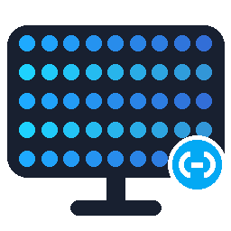

<p align="center"></p>

# LED Wall Bridge

**Inoffizielle Home-Assistant-Integration für NovaStar-LED-Player und -Controller**

[](https://github.com/TiWe1998/ha-led-wall-bridge/releases)
[](https://hacs.xyz/)
[](https://github.com/TiWe1998/ha-led-wall-bridge/actions/workflows/validate.yml)
[](LICENSE)

🇬🇧 [English](README.md)

Steuere deine LED-Walls mit NovaStar-Playern (z. B. **T-Serie**, **Taurus**) direkt aus Home
Assistant – Helligkeit, Lautstärke, Screenshots, Zeitpläne und mehr. Alles läuft **lokal in deinem
Netzwerk**; ein VNNOX-Cloud-Konto ist optional.

[](https://my.home-assistant.io/redirect/hacs_repository/?owner=TiWe1998&repository=ha-led-wall-bridge&category=integration)

> ℹ️ Dies ist ein Community-Projekt und steht **in keiner Verbindung zu NovaStar** – es wird von
> NovaStar weder unterstützt noch empfohlen. NovaStar, VNNOX, ViPlex und Taurus sind Marken ihrer
> jeweiligen Inhaber.

---

## Was du bekommst

Die Integration erkennt automatisch, was dein Controller kann, und zeigt nur an, was funktioniert.

| Name in Home Assistant | Was es macht |
|---|---|
| **LED-Wall** (Licht) | Helligkeit 0–100 % und an/aus. Hat der Controller kein Bildschirm-An/Aus, setzt „aus“ die Helligkeit auf 0 und „an“ stellt die letzte Helligkeit wieder her. |
| **Helligkeit** | Dasselbe als Schieberegler in Prozent. |
| **Lautstärke** | Lautstärke in Prozent. |
| **Werte dauerhaft speichern** | Siehe [unten](#werte-dauerhaft-speichern). |
| **Bildschirminhalt** | Ein Bild von dem, was die Wall gerade zeigt (jede Minute aktualisiert). |
| **Screenshot aktualisieren** | Macht sofort ein neues Bild. |
| **Bildschirm** | Bildschirm an/aus (nur wenn der Controller das kann). |
| **Relais** | Schaltet den Relais-Ausgang des Controllers (nur bei Modellen mit Relais). |
| **Helligkeitszeitplan (Gerät)** | Schaltet die *auf dem Controller* gespeicherten Helligkeitszeitpläne ein oder aus. |
| **Ein/Aus-Zeitplan (Gerät)** | Schaltet den *auf dem Controller* gespeicherten Ein/Aus-Zeitplan ein oder aus. |
| **Neu starten** | Startet den Controller neu. |
| **Zeit synchronisieren** | Überträgt Uhrzeit und Zeitzone von Home Assistant auf den Controller. |
| Diagnose | Firmware, Android-Version, Gerätezeit, Zeitzone, … |

Mit dem optionalen **VNNOX-Cloud-Konto** bekommst du zusätzlich für jede Wall des Kontos:
**Online (VNNOX-Cloud)**, **Zuletzt online**, **Player-Version** und **IP-Adresse**. Walls, die nur in
der Cloud sind (nicht lokal eingerichtet), erscheinen als eigene Geräte – praktisch, um mehrere
Standorte im Blick zu behalten.

---

## Installation

### Mit HACS (empfohlen)

**Mit einem Klick:** [](https://my.home-assistant.io/redirect/hacs_repository/?owner=TiWe1998&repository=ha-led-wall-bridge&category=integration)

oder von Hand:

1. In Home Assistant **HACS** öffnen.
2. Oben rechts: **⋮ → Benutzerdefinierte Repositories**.
3. Die Adresse dieses Repositorys einfügen, Typ **Integration** wählen, **Hinzufügen** klicken.
4. Nach **LED Wall Bridge** suchen, öffnen und **Herunterladen** klicken.
5. Home Assistant **neu starten** (Einstellungen → System → oben rechts ⏻ → Neu starten).

### Manuell
Den Ordner `custom_components/novastar_terminal` in den Ordner `custom_components` deiner
Home-Assistant-Konfiguration kopieren und Home Assistant neu starten.

---

## LED-Wall hinzufügen

**Du brauchst:**
- die **IP-Adresse** des Controllers (steht in deinem Router oder in ViPlex Express),
- die **Seriennummer (SN)** (auf dem Typenschild des Controllers oder in ViPlex Express),
- **Benutzername und Passwort** des Controllers – dieselben wie in **ViPlex Express**
  (Benutzername ist meist `admin`).

**Schritte:**

[](https://my.home-assistant.io/redirect/config_flow_start/?domain=novastar_terminal)

oder von Hand:
1. **Einstellungen → Geräte & Dienste → Integration hinzufügen**.
2. Nach **LED Wall Bridge** suchen und auswählen.
3. **LED-Wall / Controller (lokales Netzwerk)** wählen.
4. Felder ausfüllen – unter jedem Feld steht eine kurze Erklärung – und **Absenden** klicken.

> ⚠️ Nach **3 falschen Passwörtern** sperrt der Controller Anmeldungen für **60 Sekunden**. Einfach
> eine Minute warten.

Für jede weitere Wall diese Schritte wiederholen.

---

## Optional: VNNOX-Cloud-Konto

Nur nötig, wenn du den Online-Status aus der VNNOX-Cloud sehen möchtest. **Ein Konto reicht für alle
Walls.**

**Woher bekomme ich die Werte?**
1. Die **NovaCloud Open Platform** für deine Region öffnen:
   - Europa: **<https://open-eu.vnnox.com>**
   - USA: **<https://open-us.vnnox.com>**
2. Oben rechts auf **Log In** klicken und mit deinem normalen **VNNOX-Konto** anmelden.
3. Oben auf den Reiter **Authentication** klicken.
4. Dort stehen drei Werte:
   - **Interface Access Domain Name** (z. B. `https://open-eu.vnnox.com`)
   - **AppKey**
   - **AppSecret**

**In Home Assistant hinzufügen:**
1. **Einstellungen → Geräte & Dienste → Integration hinzufügen → LED Wall Bridge**.
2. **VNNOX-Cloud-Konto** wählen.
3. Die drei Werte aus dem Portal in die Felder kopieren und **Absenden** klicken.

> ❗ **Nicht** die richtigen Werte: die *„VNNOX Authentifizierungsinformationen“* (Serveradresse,
> Authentifizierungs-Benutzername/-kennwort). Die dienen nur dazu, einen Player an VNNOX zu binden,
> und funktionieren hier nicht.

> Die Meldung *„VNNOX lehnt die Zugangsdaten ab“* bedeutet fast immer, dass die Domain falsch ist
> (z. B. `open-us…` statt `open-eu…`).

---

## Werte dauerhaft speichern

Diesen Schalter findest du auf der Geräteseite unter **Steuerung**.

- **An (Standard):** Helligkeit und Lautstärke werden im Controller gespeichert. Nach einem Neustart
  oder Stromausfall kommt die Wall mit dem letzten Wert zurück.
- **Aus:** Der Wert gilt nur bis zum nächsten Neustart.

**Wann sollte ich ihn ausschalten?** Wenn eine Automation die Helligkeit sehr oft ändert (z. B. jede
Minute). Jedes dauerhafte Speichern ist ein Schreibvorgang im Speicher des Controllers – mit
ausgeschaltetem Schalter schonst du ihn. Bei ein paar Änderungen am Tag kannst du ihn anlassen.

---

## Einstellungen

Geräteseite → **⚙ (Konfigurieren)**:
- **Aktualisierungsintervall** – wie oft Werte abgefragt werden (Standard 30 Sekunden).
- **Screenshot-Intervall** – wie oft ein neues Bild gemacht wird (Standard 60 Sekunden, `0` = nur
  über den Button „Screenshot aktualisieren“).

---

## Gut zu wissen

- **Zeitpläne auf dem Controller haben Vorrang:** Ist auf dem Controller ein Helligkeitszeitplan
  aktiv (z. B. in ViPlex angelegt), überschreibt er zu den geplanten Zeiten die Werte aus Home
  Assistant. Soll Home Assistant allein steuern, **Helligkeitszeitplan (Gerät)** ausschalten.
- **Passwort geändert?** Home Assistant zeigt eine Meldung und fragt nach dem neuen Passwort.
- **IP-Adresse geändert?** Geräteseite → **⋮ → Neu konfigurieren**.

## Beispiel: Helligkeit nach Sonnenstand

```yaml
alias: LED-Wall Helligkeit nach Sonne
triggers:
  - trigger: state
    entity_id: sun.sun
    attribute: elevation
actions:
  - action: light.turn_on
    target:
      entity_id: light.led_wall   # an deine Entität anpassen
    data:
      brightness_pct: >
        
        {{ 100 if e > 20 else 60 if e > 5 else 35 if e > -6 else 15 }}
mode: restart
```

## Fehlersuche

Ausführliches Logging einschalten (in `configuration.yaml` eintragen, dann neu starten):

```yaml
logger:
  logs:
    custom_components.novastar_terminal: debug
```

Geräteseite → **⋮ → Diagnose herunterladen** erstellt eine Datei für Fehlermeldungen (Passwörter,
Seriennummern und Schlüssel werden automatisch entfernt).
