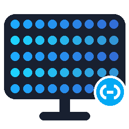

<p align="center"></p>

# LED Wall Bridge

**Unofficial Home Assistant integration for NovaStar LED players and controllers**

[](https://github.com/TiWe1998/ha-led-wall-bridge/releases)
[](https://hacs.xyz/)
[](https://github.com/TiWe1998/ha-led-wall-bridge/actions/workflows/validate.yml)
[](LICENSE)

🇩🇪 [Deutsche Anleitung](README.de.md)

Control your LED walls with NovaStar players (e.g. **T series**, **Taurus**) directly from Home
Assistant – brightness, volume, screenshots, schedules and more. Everything runs **locally in your
network**; a VNNOX cloud account is optional.

[](https://my.home-assistant.io/redirect/hacs_repository/?owner=TiWe1998&repository=ha-led-wall-bridge&category=integration)

> ℹ️ This is a community project and is **not affiliated with, endorsed or supported by NovaStar**.
> NovaStar, VNNOX, ViPlex and Taurus are trademarks of their respective owners.

Available in English, German, French, Spanish, Italian, Dutch, Polish, Portuguese (BR), Swedish,
Danish, Czech and Chinese.

---

## What you get

The integration detects automatically what your controller supports and only shows what works.

| Name in Home Assistant | What it does |
|---|---|
| **LED wall** (light) | Brightness 0–100 % and on/off. If the controller has no screen on/off function, “off” sets the brightness to 0 and “on” restores the last brightness. |
| **Brightness** | The same as a slider in percent. |
| **Volume** | Volume in percent. |
| **Store values permanently** | See [below](#store-values-permanently). |
| **Screen content** | A picture of what the wall is currently showing (updated every minute). |
| **Refresh screenshot** | Takes a new picture immediately. |
| **Screen** | Screen on/off (only if the controller supports it). |
| **Relay** | Switches the relay output of the controller (only on models with a relay). |
| **Brightness schedule (device)** | Switches the brightness schedules stored *on the controller* on or off. |
| **On/off schedule (device)** | Switches the screen on/off schedule stored *on the controller* on or off. |
| **Restart** | Restarts the controller. |
| **Sync time** | Sends the time and time zone of Home Assistant to the controller. |
| Diagnostics | Firmware, Android version, device time, time zone, … |

With the optional **VNNOX cloud account** you also get for every wall of the account:
**Online (VNNOX cloud)**, **Last online**, **Player version** and **IP address**. Walls that are only
in the cloud (not set up locally) appear as their own devices – handy for monitoring several sites.

---

## Installation

### With HACS (recommended)

**One click:** [](https://my.home-assistant.io/redirect/hacs_repository/?owner=TiWe1998&repository=ha-led-wall-bridge&category=integration)

or manually:

1. In Home Assistant open **HACS**.
2. Top right: **⋮ → Custom repositories**.
3. Paste the address of this repository, choose type **Integration**, click **Add**.
4. Search for **LED Wall Bridge**, open it and click **Download**.
5. **Restart** Home Assistant (Settings → System → top right ⏻ → Restart).

### Manually
Copy the folder `custom_components/led_wall_bridge` into the folder `custom_components` of your
Home Assistant configuration and restart Home Assistant.

---

## Adding an LED wall

**You need:**
- the **IP address** of the controller (shown in your router or in ViPlex Express),
- the **serial number (SN)** (on the label of the controller or in ViPlex Express),
- **username and password** of the controller – the same ones you use in **ViPlex Express**
  (username is usually `admin`).

**Steps:**

[](https://my.home-assistant.io/redirect/config_flow_start/?domain=led_wall_bridge)

or manually:
1. **Settings → Devices & services → Add integration**.
2. Search for **LED Wall Bridge** and select it.
3. Choose **LED wall / controller (local network)**.
4. Fill in the fields – every field has a short explanation below it – and click **Submit**.

> ⚠️ After **3 wrong passwords** the controller blocks logins for **60 seconds**. Just wait a minute.

Repeat these steps for every additional wall.

---

## Optional: VNNOX cloud account

Only needed if you want to see the online status from the VNNOX cloud. **One account is enough for
all walls.**

**Where do I get the values?**
1. Open the **NovaCloud Open Platform** for your region:
   - Europe: **<https://open-eu.vnnox.com>**
   - USA: **<https://open-us.vnnox.com>**
2. Click **Log In** (top right) and sign in with your normal **VNNOX account**.
3. Click the tab **Authentication** at the top.
4. There you see three values:
   - **Interface Access Domain Name** (e.g. `https://open-eu.vnnox.com`)
   - **AppKey**
   - **AppSecret**

**Add in Home Assistant:**
1. **Settings → Devices & services → Add integration → LED Wall Bridge**.
2. Choose **VNNOX cloud account**.
3. Copy the three values from the portal into the fields and click **Submit**.

> ❗ **Not** the right values: the *“VNNOX authentication information”* (server address, authentication
> username/password). Those are only used to bind a player to VNNOX and do not work here.

> The error *“VNNOX rejected the credentials”* almost always means the domain is wrong
> (e.g. `open-us…` instead of `open-eu…`).

---

## Store values permanently

You find this switch on the device page under **Controls**.

- **On (default):** brightness and volume are saved on the controller. After a restart or power cut
  the wall comes back with the last value.
- **Off:** the value only applies until the next restart.

**When should I switch it off?** If an automation changes the brightness very often (e.g. every
minute). Each permanent save is a write to the controller's memory – with the switch off, you
protect it. For a few changes per day you can leave it on.

---

## Settings

Device page → **⚙ (Configure)**:
- **Update interval** – how often values are read (default 30 seconds).
- **Screenshot interval** – how often a new picture is taken (default 60 seconds, `0` = only via the
  “Refresh screenshot” button).

---

## Good to know

- **Schedules on the controller win:** if a brightness schedule is active on the controller (e.g.
  created in ViPlex), it overwrites the values from Home Assistant at the scheduled times. If Home
  Assistant should be in charge, switch off **Brightness schedule (device)**.
- **Changed password?** Home Assistant shows a message and asks for the new password.
- **Changed IP address?** Device page → **⋮ → Reconfigure**.

## Example: brightness by the position of the sun

```yaml
alias: LED wall brightness by sun
triggers:
  - trigger: state
    entity_id: sun.sun
    attribute: elevation
actions:
  - action: light.turn_on
    target:
      entity_id: light.led_wall   # adjust to your entity
    data:
      brightness_pct: >
        
        {{ 100 if e > 20 else 60 if e > 5 else 35 if e > -6 else 15 }}
mode: restart
```

## Troubleshooting

Enable detailed logging (add to `configuration.yaml`, then restart):

```yaml
logger:
  logs:
    custom_components.led_wall_bridge: debug
```

Device page → **⋮ → Download diagnostics** creates a file for bug reports (passwords, serial numbers
and keys are removed automatically).

## Security

See [SECURITY.md](SECURITY.md) for how the integration protects your data and how to report
vulnerabilities privately.

## For developers

```bash
pip install pytest-homeassistant-custom-component
pytest
```

APIs used: [NovaStar Terminal Open API](https://terminal-open-en.vnnox.com/) (local) and
[NovaCloud Open Platform](https://developer-en.vnnox.com/) (cloud).
